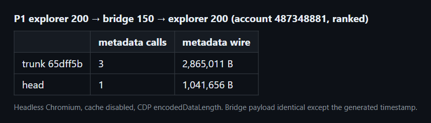
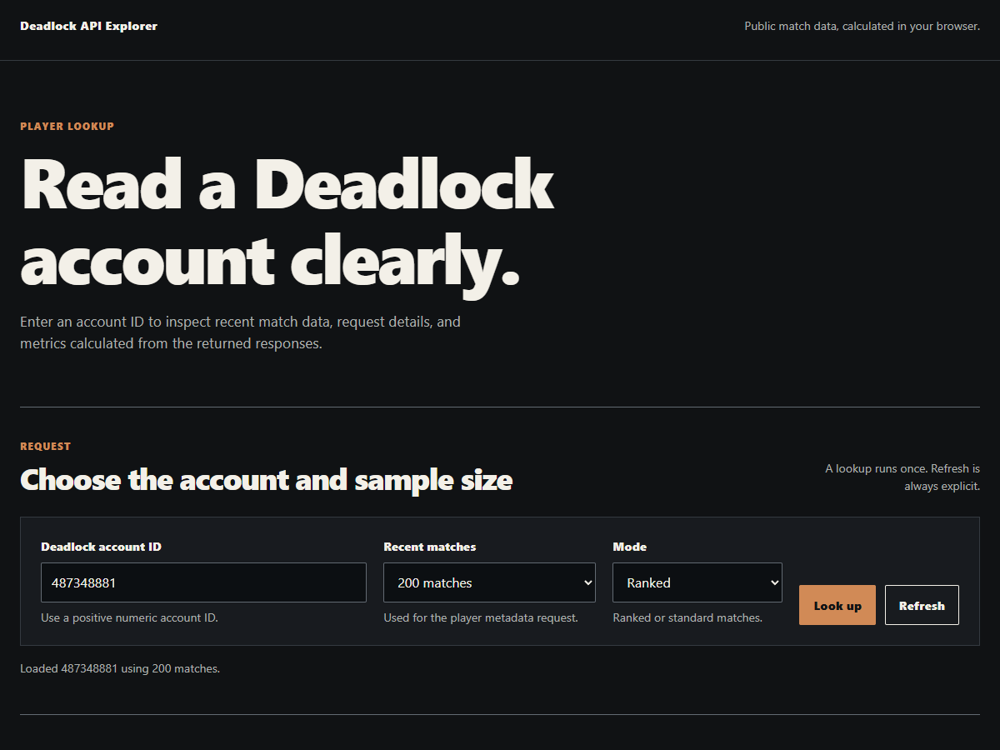

# perf(cache): keep every player prefix across explorer and bridge (P1)

Commit `cea7302` in `deadlock-stats-bridge`.

## Summary

```diff
 explorer fetch 200
-  store prefixes 25, 50, 100, 200
+  store prefixes 25, 50, 100, 150, 200
 bridge fetch 150
-  store prefixes 50, 100, 150   (replaces the 200 entry)
+  store prefixes 25, 50, 100, 150
 writePlayerCache(entry)
+  if a fresh entry with a larger maxMatches exists
+    keep it
   write entry
```

## Evidence

- **Before:** explorer 200, bridge 150, explorer 200 for account 487348881 made 3 metadata calls, 2,865,011 B.
  **After:** 1 metadata call, 1,041,656 B. The bridge payload is identical apart from its `generated` timestamp.





- Bridge 150 first, then explorer 200, makes 2 calls. Bridge 50 after explorer 200 makes 0.
- `node --test` passes 149 tests, including the new one-fetch, bridge-first, stale-versus-fresh and metric-parity cases in `test/cache.test.js`.

## Merge Danger

**Door:** two-way

Reverting restores the old writers. Old cache entries stay readable because the entry format did not change.

**Blast Radius:** cache

A fresh 200 entry now blocks a smaller write until it expires. Explicit refresh still writes an equal-size entry.
