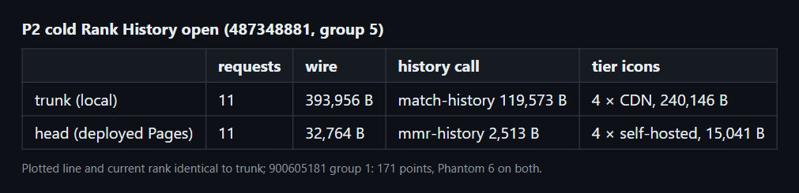
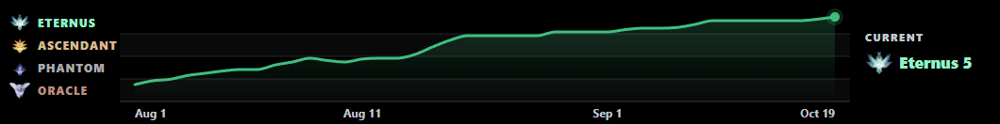
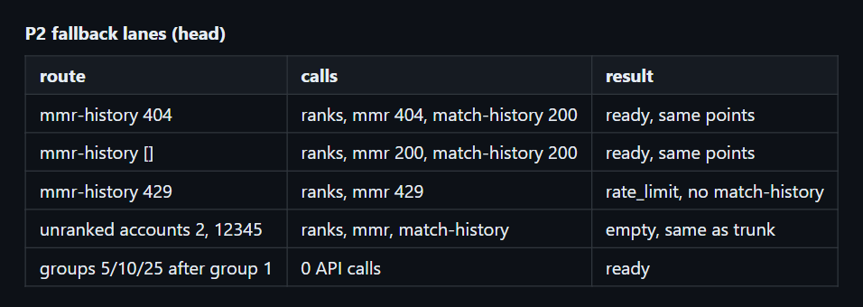

# perf(rank-history): mmr-history with bounded fallback and self-hosted tier icons (P2)

Commit `090e253` in `deadlock-stats-bridge`.

## Summary

```diff
 loadHistory(account)
-  GET match-history                      (5,164 rows x 28 fields)
+  unless mmr-history failed in the last hour
+    GET mmr-history                      (one row per ranked match)
+    on 404/410/5xx, bad shape or zero rows
+      remember failure for 1 h
+      GET match-history with the time left in one 20 s budget
+    on 429 or abort
+      stop, no fallback
 chart icons
-  CDN large_webp (50-90 KB each)
+  ./assets/ranks/tierNN.webp (64 px lossless, 1.8-4.5 KB)
```

## Evidence

- **Before:** a cold open for 487348881 group 5 took 393,956 B over 11 requests, with a 119,573 B history and 240,146 B of icons.
  **After:** the deployed page takes 32,764 B over 11 requests, with a 2,513 B history and 15,041 B of icons. The plotted line and current rank are identical.



Trunk chart:



Head chart:


Deployed:




- Account 900605181 group 1 shows 171 points and Phantom 6 on both trunk and head in the same run.
- The parity fixture covers both accounts, and `node --test` passes 149 tests.

## Merge Danger

**Door:** two-way

Reverting restores `match-history` and the CDN icons. The `dlrh:ranks:v2` and `dlrh:mmr-down:v1` keys expire on their own.

**Blast Radius:** chart

- `mmr-history` is deprecated upstream. The fallback covers errors and empty results, but not a partial non-empty list.
- Unranked players make one extra 2 KB request.
- The icons go stale if Valve changes the rank art. Rerun `tools/make-rank-thumbnails.mjs` to regenerate them.
