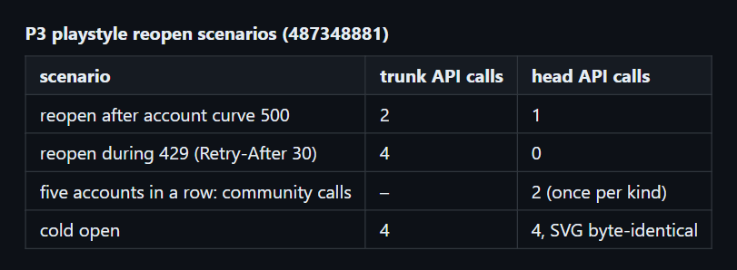
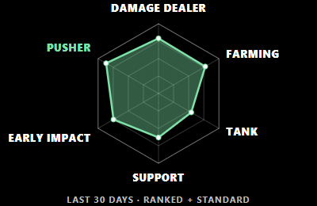
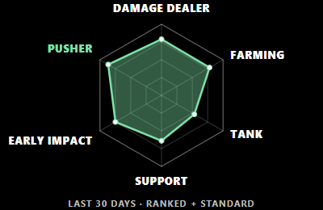

# perf(playstyle): per-resource cache, in-flight sharing, persisted 429 cooldown (P3)

Commit `394ea0c` in `deadlock-stats-bridge`.

## Summary

```diff
 runPlaystyle(account)
-  community pair = cached or fetch both     (one failure drops both)
-  account pair   = cached or fetch both
+  for each of 4 resources
+    cached?            use it
+    in flight?         share the promise
+    analytics cooldown? fail as rate_limit, no fetch
+    fetch, validate, cache on its own
+  on 429: cooldown = Retry-After (default 60 s, cap 1 h)
```

## Evidence

- **Before:** after the account curve failed, the next open refetched 2 account calls. A reopen during a 429 made 4 calls.
  **After:** 1 call and 0 calls. A cold open still makes 4 calls, and its SVG is byte-identical to trunk.



Trunk radar:


Head radar:



Deployed radar:



- Five accounts in a row fetch the community pair once.
- `node --test` passes 149 tests, including the partial-failure, cooldown, sharing, abort and corrupt-entry cases.

## Merge Danger

**Door:** two-way

Cache keys moved to `dlps:*:v2:`. The old pair entries are orphaned and expire on their own.

**Blast Radius:** radar

During a cooldown, a profile with missing resources shows the busy message without trying the API.
