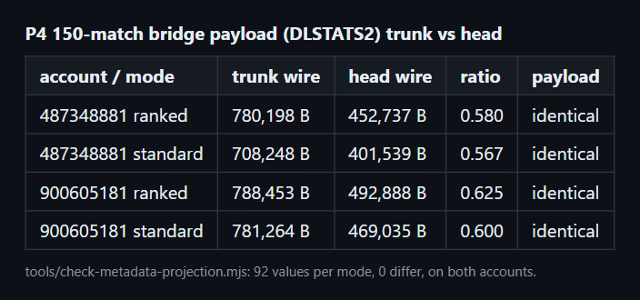

# perf(api): project the metadata query instead of full final stats (P4)

Commit `d9d9002` in `deadlock-stats-bridge`.

## Summary

```diff
 buildMetadataUrl(account, mode, limit)
   include_player_kda=true
-  include_player_final_stats=true
-  extra_player_columns=last_hits,denies,mvp_rank
+  extra_player_columns=last_hits,denies,mvp_rank,stats.net_worth,stats.player_damage,... (12 stats)
 fetchMetadata
+  normalizeMetadataProjection: player.stats_X -> player.stats.X
```

Teammates stay in the response, so kill participation keeps its denominator. `only_filtered_players` stays off.

## Evidence

- **Before:** a 150-match bridge payload for 487348881 ranked was 780,198 B.
  **After:** 452,737 B with an identical payload. Three more account and mode pairs are identical at 57 to 63 percent of the bytes.



- `tools/check-metadata-projection.mjs` compared 92 values per mode on two accounts and found 0 differences.
- The scalar `net_worth` column changed net worth per minute, so it is not used.
- `node --test` passes 149 tests, including `test/metadata-projection.test.js`.

## Merge Danger

**Door:** two-way

Reverting restores the full query. Cached entries hold computed metrics, not raw responses.

**Blast Radius:** stats

If the API renames a `stats.*` column, the affected metric reads null. Rerun the check tool after API changes.
