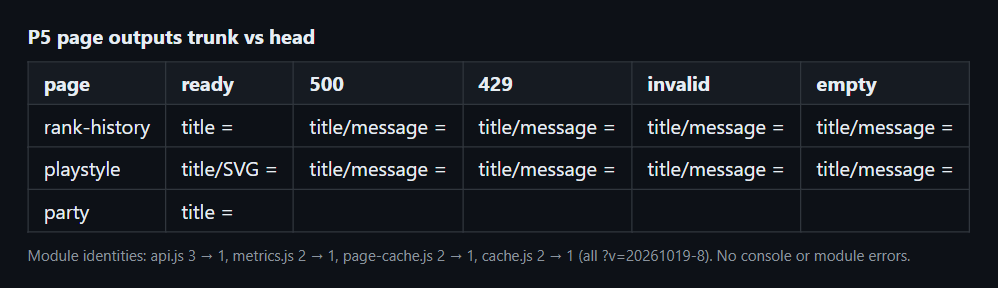
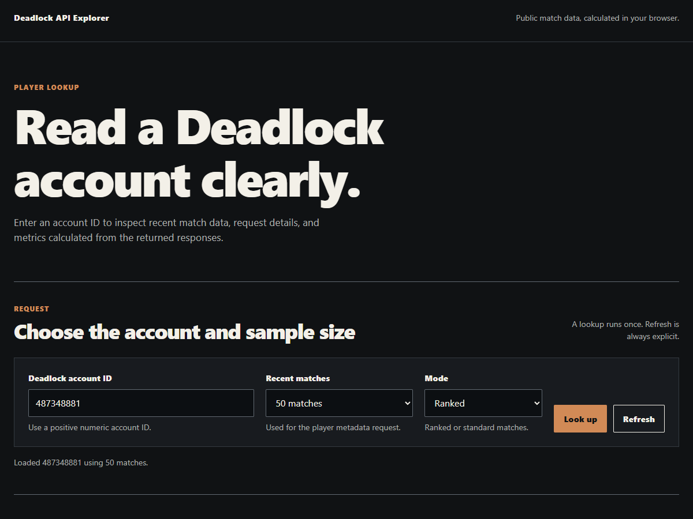

# refactor(pages): shared page-status helper and one ?v= identity per module (P5)

Commit `c84aca3` in `deadlock-stats-bridge`.

## Summary

```diff
 src/
+├── page-status.js    # createStatus(prefix, v), errorCode, escapeText, startPage
 ├── rank-history.js   # parse, load, render; status from page-status
 └── playstyle.js      # parse, load, render; status from page-status
 imports
-  api.js?v=20260827-1 | 20261018-1 | 20261019-2
-  metrics.js?v=20260827-1 | 20261019-2
+  every module ?v=20261019-8
```

## Evidence

- **Before:** `api.js` loaded under 3 identities, and `metrics.js`, `page-cache.js` and `cache.js` under 2 each.
  **After:** one identity per module. `test/versions.test.js` enforces this.





- Both chart pages publish the same titles and messages as trunk for ready, 500, 429, invalid-query and empty outcomes. The playstyle SVG is byte-identical.
- The party page title matches trunk, and the explorer loads with no console errors.

## Merge Danger

**Door:** two-way

The change is pure structure plus version strings.

**Blast Radius:** none

A browser holding pre-deploy modules refetches them once.
